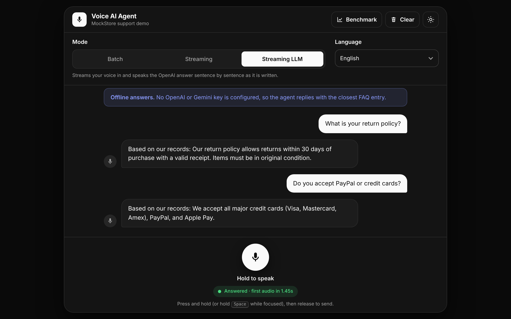
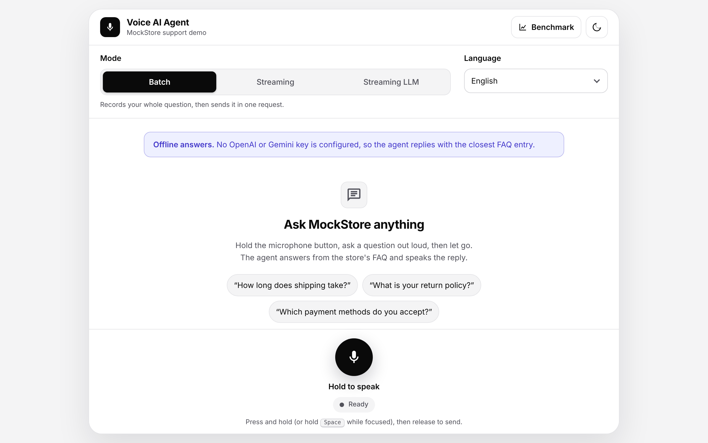
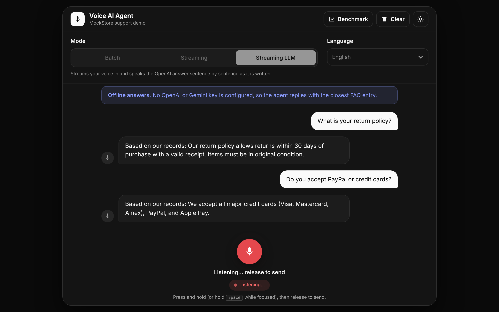
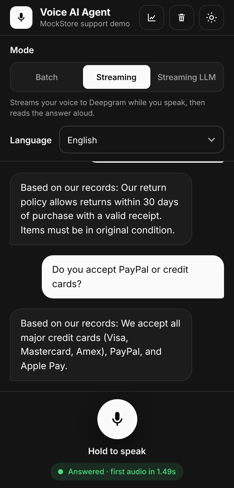
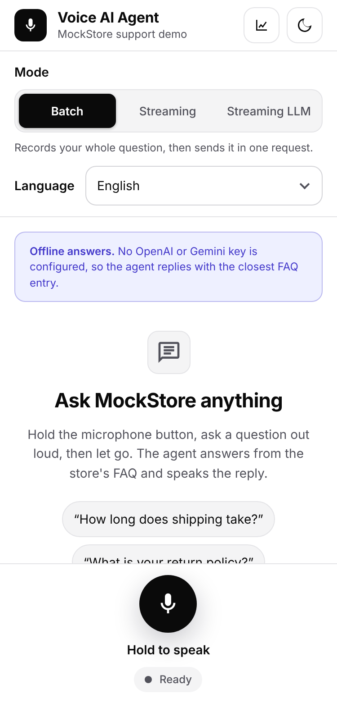
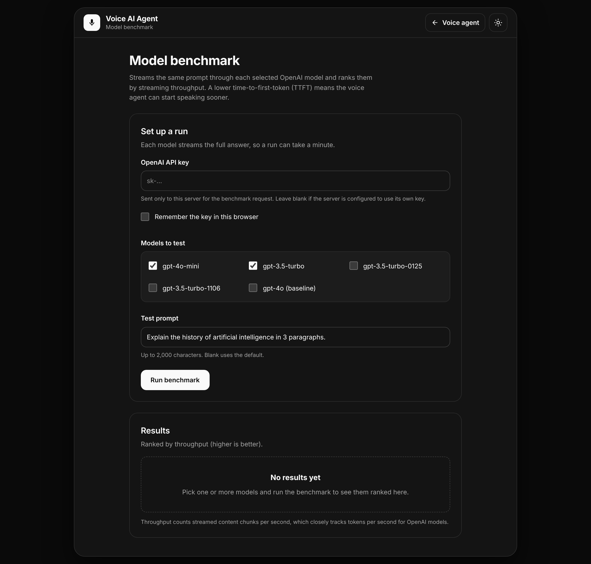
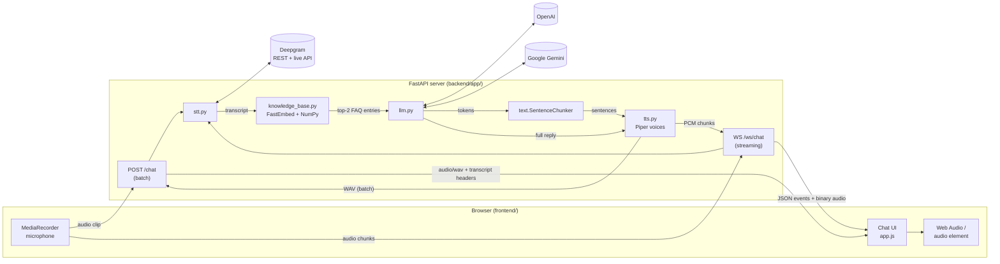

# Voice AI Agent

**Hold a button, ask a question out loud, and hear the answer a moment later.** A full-stack, real-time
voice assistant for customer support, built with Deepgram speech-to-text, retrieval-augmented answers
from OpenAI or Google Gemini, and Piper text-to-speech that runs on your own machine.




---

## Table of contents

- [Overview](#overview)
- [Screenshots](#screenshots)
- [Features](#features)
- [Tech stack](#tech-stack)
- [Architecture](#architecture)
- [Project structure](#project-structure)
- [Getting started](#getting-started)
- [Configuration](#configuration)
- [Running the app](#running-the-app)
- [Usage](#usage)
- [API reference](#api-reference)
- [Scripts and commands](#scripts-and-commands)
- [Testing and code quality](#testing-and-code-quality)
- [Deployment](#deployment)
- [Troubleshooting and FAQ](#troubleshooting-and-faq)
- [Known limitations](#known-limitations)
- [Roadmap ideas](#roadmap-ideas)
- [Contributing](#contributing)
- [License](#license)
- [Acknowledgements](#acknowledgements)

## Overview

Voice interfaces live or die by latency. A support bot that takes five seconds to start talking feels
broken, even when its answers are correct. This project is a small but complete voice agent you can
run locally to **build, measure and compare** the pieces of a speech pipeline:

1. **Listen:** the browser records your microphone. Deepgram transcribes it, either as one uploaded
   clip or live over a WebSocket while you are still talking.
2. **Retrieve:** the transcript is embedded with FastEmbed and matched against a small FAQ knowledge
   base (a fictional online shop called *MockStore*).
3. **Answer:** OpenAI or Gemini writes a short reply grounded in the retrieved facts. Without an LLM
   key, the agent reads back the best-matching FAQ entry instead.
4. **Speak:** Piper turns the reply into speech on the server. In *Streaming LLM* mode each sentence
   is spoken as soon as the model finishes writing it.

**Who it's for:** developers prototyping voice agents, people comparing request/response and
streaming designs, and anyone who wants a readable reference for wiring Deepgram, RAG, an LLM and
local TTS together in one FastAPI service.

## Screenshots

All screenshots were captured from the running app with Playwright and a fake microphone. To make
them reproducible without API keys, Deepgram was swapped for a stub that returns a fixed question.
Everything else is real: the FastAPI server, knowledge-base retrieval, the offline answer fallback,
Piper speech synthesis and the browser UI. The latencies shown are from that local run.

| Desktop, light theme (welcome state) | Desktop, recording |
| --- | --- |
|  |  |

| Phone, dark theme (conversation) | Phone, light theme (welcome state) |
| --- | --- |
|  |  |

| Model benchmark page | Not-found page |
| --- | --- |
|  |  |

## Features

**Conversation**

- **Three processing modes**, switchable from the UI:
  - **Batch:** record a clip, upload it to `POST /chat`, get back a WAV reply (Deepgram REST + Gemini).
  - **Streaming:** microphone audio streams over `WS /ws/chat` to Deepgram's live API while you speak.
    The full reply is then spoken (Gemini).
  - **Streaming LLM:** like Streaming, but OpenAI tokens are split into sentences and each sentence is
    synthesized and played as soon as it is ready, so you hear the start of the answer early.
- **Retrieval-augmented answers:** FastEmbed (`BAAI/bge-small-en-v1.5`, ONNX on the CPU) ranks the FAQ
  entries by cosine similarity, and the top two are added to the prompt.
- **Graceful degradation:** with no LLM key, or when a provider call fails, the agent answers with the
  best knowledge-base match. Only a Deepgram key is required.
- **Local, multilingual speech output:** Piper voices for English and Hindi are bundled. Other
  languages are spoken with the English voice.
- **11 speech-input options:** English, Hindi, Marathi, Tamil, Telugu, Kannada, Malayalam, Gujarati,
  Bengali and Punjabi, plus auto-detection in Batch mode.
- **Progressive audio playback:** streamed 16-bit PCM is scheduled gaplessly through the Web Audio API.

**Interface**

- **Light and dark themes** that follow the OS setting, with a toggle that remembers your choice.
- **Responsive layout** checked at 375 px (phone), 768 px (tablet) and 1280 px (desktop), with no
  horizontal scrolling and touch targets of at least 40 px.
- **Clear states everywhere:** a welcome screen with example questions, a typing indicator while the
  agent thinks, a colour-coded status pill (listening, working, speaking, answered, error) showing
  the measured latency, and readable error messages.
- **Server health banner:** on load, the page calls `/health` and warns you if the Deepgram key is
  missing, if no LLM key is configured (offline answers), or if the server cannot be reached.
- **Accessible:** press-and-hold works with mouse, touch and keyboard (hold <kbd>Space</kbd> or
  <kbd>Enter</kbd>). The page has a skip link, visible focus rings, labelled controls, and a chat log
  and status messages that screen readers announce. It passes axe-core WCAG 2 A/AA checks in both
  themes.
- **Model benchmark page** (`/report.html`) measures time-to-first-token and streaming throughput for
  OpenAI models, with inline form validation and an opt-in "remember key" option.
- **Themed 404 page**, favicons, page titles, meta descriptions and Open Graph tags.

**Engineering**

- Async FastAPI backend. Blocking SDK and Piper calls run in worker threads, and LLM generation
  overlaps with speech synthesis.
- Input validation, upload size limits, same-origin by default (CORS is opt-in), and the benchmark
  cannot spend the server's OpenAI key unless you allow it.
- 59 pytest tests that need no API keys or network access, plus Ruff, ESLint and Prettier.

## Tech stack

| Layer | Technology | Notes |
| --- | --- | --- |
| Web server | [FastAPI](https://fastapi.tiangolo.com/), [Uvicorn](https://www.uvicorn.org/) | One ASGI app serves the API, WebSocket and static frontend |
| HTTP / WebSocket clients | [httpx](https://www.python-httpx.org/), [websockets](https://websockets.readthedocs.io/) | Async calls to Deepgram and OpenAI |
| Speech-to-text | [Deepgram](https://deepgram.com/) `nova-2` | REST for Batch, live WebSocket for Streaming |
| Retrieval | [FastEmbed](https://github.com/qdrant/fastembed) + NumPy | `BAAI/bge-small-en-v1.5`, cosine similarity, in memory |
| Language models | OpenAI Chat Completions, Google Gemini (`google-genai`) | `gpt-4o-mini` and `gemini-2.5-flash` by default |
| Text-to-speech | [Piper](https://github.com/rhasspy/piper) (`piper-tts`) | ONNX voices bundled in `backend/voices/` |
| Frontend | HTML, CSS and vanilla JavaScript | MediaRecorder, WebSocket and Web Audio. No framework and no build step |
| Config | python-dotenv | `.env` in the project root or in `backend/` |
| Testing | pytest, pytest-asyncio, `httpx.MockTransport` | Providers mocked, deterministic test embedder |
| Code quality | Ruff (lint + format), ESLint 9, Prettier 3 | Configs in `pyproject.toml`, `eslint.config.mjs` and `.prettierrc.json` |

## Architecture



### Request flow per mode

| Step | Batch (`POST /chat`) | Streaming (`WS /ws/chat`, `use_llm=false`) | Streaming LLM (`WS /ws/chat`, `use_llm=true`) |
| --- | --- | --- | --- |
| Audio in | Whole clip after you release the button | 100 ms chunks while you speak | 100 ms chunks while you speak |
| Speech-to-text | Deepgram REST (`detect_language` when "auto") | Deepgram live WebSocket | Deepgram live WebSocket |
| Answer | Gemini, or the FAQ fallback | Gemini, or the FAQ fallback | OpenAI streamed token by token, or the FAQ fallback |
| Speech out | One WAV file | Raw PCM chunks after a WAV header | PCM per sentence while the LLM is still writing |
| Transcripts | Hex-encoded `X-User-Transcript` / `X-Agent-Transcript` headers | JSON `transcript` events | JSON `transcript` events, with agent text growing as it streams |

### WebSocket protocol (`/ws/chat`)

Client to server:

1. One JSON text frame with the configuration:
   `{"language": "en", "use_llm": true}`. Optional fields: `encoding` and `sample_rate` for raw audio.
2. Binary frames of audio (the browser sends WebM/Opus chunks from MediaRecorder).
3. One **empty** binary frame, which means "I have finished speaking".

Server to client:

| Event | Shape | Meaning |
| --- | --- | --- |
| `transcript` | `{"type":"transcript","speaker":"user","text":"..."}` | What Deepgram heard |
| `transcript` | `{"type":"transcript","speaker":"agent","text":"...","final":true?}` | Agent reply. In LLM mode the text grows; `final: true` marks the complete reply |
| `audio_start` | `{"type":"audio_start"}` | Binary audio follows |
| *(binary)* | 44-byte WAV header, then 16-bit mono PCM | Spoken reply, streamed |
| `audio_end` | `{"type":"audio_end"}` | All audio has been sent |
| `error` | `{"type":"error","message":"No speech detected"}` | Something failed. The socket then closes |

## Project structure

```
.
├── backend/
│   ├── app/
│   │   ├── __init__.py
│   │   ├── main.py            # App factory, routes (/chat, /ws/chat, /benchmark_stream, /health), static mount
│   │   ├── config.py          # Settings dataclass built from environment variables / .env
│   │   ├── stt.py             # Deepgram REST + live WebSocket client, query building, transcript parsing
│   │   ├── llm.py             # OpenAI (streaming + non-streaming) and Gemini clients with offline fallbacks
│   │   ├── knowledge_base.py  # MockStore FAQ documents + lazy, thread-safe FastEmbed cosine search
│   │   ├── tts.py             # Piper voice loading, WAV helpers, sentence-by-sentence streaming synthesis
│   │   └── text.py            # Prompt building, sentence chunker, SSE parsing, header encoding
│   ├── tests/                 # pytest suite (conftest.py has the fake TTS and hashing embedder)
│   ├── voices/                # Piper ONNX voices: en_US-lessac-medium, hi_IN-rohan-medium (~120 MB)
│   ├── requirements.txt       # Runtime dependencies
│   └── requirements-dev.txt   # + pytest, pytest-asyncio, ruff
├── frontend/                  # Served as static files at "/"
│   ├── index.html             # Voice chat page
│   ├── app.js                 # Recording, WebSocket protocol, PCM player, UI states, health banner
│   ├── report.html            # Model benchmark page
│   ├── report.js              # Benchmark form, validation and results table
│   ├── 404.html               # Not-found page (served automatically for unknown paths)
│   ├── theme.js               # Light/dark theme toggle shared by all pages
│   ├── style.css              # Design tokens + components for every page
│   └── favicon.svg, favicon-32.png, apple-touch-icon.png
├── scripts/
│   ├── smoke_batch.py         # Send an audio file to POST /chat and save the reply
│   ├── smoke_stream.py        # Stream an audio file over /ws/chat and print events / timings
│   └── run_benchmark.py       # Command-line version of the benchmark page
├── docs/screenshots/          # README screenshots
├── .github/workflows/ci.yml   # Lint + tests on push / pull request
├── .env.example               # Every supported setting, commented
├── pyproject.toml             # Ruff and pytest configuration
├── package.json               # ESLint + Prettier for the frontend (no build step)
└── eslint.config.mjs, .prettierrc.json
```

## Getting started

### Prerequisites

| Requirement | Version | Why |
| --- | --- | --- |
| Python | 3.10 or newer (CI uses 3.12) | Backend |
| pip + venv | bundled with Python | Install dependencies |
| Deepgram API key | free tier is fine | **Required** for speech-to-text. Get one at <https://console.deepgram.com/> |
| OpenAI and/or Gemini key | optional | Generated answers. Without them you get FAQ answers |
| A modern browser | Chrome, Edge, Firefox or Safari | Microphone + Web Audio. Needs `localhost` or HTTPS |
| Node.js | 18+ (CI uses 22) | **Only** for the frontend linters |
| Internet access on first run | | FastEmbed downloads the embedding model (~70 MB) from Hugging Face once and caches it |

### Installation

```bash
# 1. Clone
git clone https://github.com/jeevithg090/Deepgram-Voice.git
cd Deepgram-Voice

# 2. Create and activate a virtual environment
python3 -m venv .venv
source .venv/bin/activate            # Windows: .venv\Scripts\activate

# 3. Install backend dependencies
pip install -r backend/requirements-dev.txt   # includes test + lint tools
# or, for runtime only:
# pip install -r backend/requirements.txt

# 4. Configure keys
cp .env.example .env                 # then edit .env and set at least DEEPGRAM_API_KEY

# 5. (Optional) frontend lint tooling
npm ci
```

## Configuration

Settings come from environment variables. A `.env` file in the project root or in `backend/` is also
loaded, but real environment variables always win. See [`.env.example`](.env.example).

| Variable | Required | Default | Description |
| --- | --- | --- | --- |
| `DEEPGRAM_API_KEY` | **Yes** | none | Deepgram key for speech-to-text. Without it `/chat` returns 503 and streaming returns an error event |
| `OPENAI_API_KEY` | No | none | Enables generated answers in **Streaming LLM** mode. Can also back the benchmark (see below) |
| `GEMINI_API_KEY` | No | none | Enables generated answers in **Batch** and **Streaming** modes |
| `DEEPGRAM_MODEL` | No | `nova-2` | Deepgram model name |
| `OPENAI_MODEL` | No | `gpt-4o-mini` | OpenAI chat model |
| `GEMINI_MODEL` | No | `gemini-2.5-flash` | Gemini model |
| `EMBEDDING_MODEL` | No | `BAAI/bge-small-en-v1.5` | FastEmbed model used for retrieval |
| `CORS_ORIGINS` | No | empty | Comma-separated origins allowed to call the API cross-origin. Empty means same-origin only |
| `MAX_UPLOAD_BYTES` | No | `10485760` (10 MiB) | Upload limit for `POST /chat` (larger uploads get 413) |
| `HTTP_TIMEOUT_SECONDS` | No | `30` | Timeout for outbound provider calls |
| `ENABLE_BENCHMARK` | No | `true` | Turns `POST /benchmark_stream` on or off. When off, the benchmark page shows a notice |
| `BENCHMARK_ALLOW_SERVER_KEY` | No | `false` | Lets the benchmark use `OPENAI_API_KEY` when the visitor leaves the key blank. **Keep this off on public servers** |
| `FRONTEND_DIR` | No | `<repo>/frontend` | Directory served as the static UI |
| `VOICES_DIR` | No | `<repo>/backend/voices` | Directory holding the Piper `.onnx` voices and their `.onnx.json` configs |

Boolean variables accept `1`, `true`, `yes` or `on` (case-insensitive).

**Which keys do I need?**

| You set | Batch | Streaming | Streaming LLM |
| --- | --- | --- | --- |
| Deepgram only | FAQ answer | FAQ answer | FAQ answer |
| Deepgram + Gemini | Gemini | Gemini | FAQ answer |
| Deepgram + OpenAI | FAQ answer | FAQ answer | OpenAI (streamed) |
| All three | Gemini | Gemini | OpenAI (streamed) |

## Running the app

### Development

```bash
cd backend
uvicorn app.main:app --reload --port 8000
```

Open <http://localhost:8000>. The server accepts requests straight away and loads the embedding model
and English voice in the background. `GET /health` shows `"knowledge_base_ready": true` once warm-up
is done (the first question also triggers it).

Frontend files are served straight from `frontend/`, so edits to HTML, CSS or JS only need a browser
refresh. There is no build step.

### Production

```bash
pip install -r backend/requirements.txt
cd backend
uvicorn app.main:app --host 0.0.0.0 --port "${PORT:-8000}" --workers 1 --proxy-headers
```

Put it behind HTTPS (see [Deployment](#deployment)). Browsers only allow the microphone on `localhost`
or secure origins.

## Usage

### In the browser

1. Open the app. If a key is missing, a banner at the top of the conversation tells you which one.
2. Pick a **mode**. The hint under the mode buttons explains what each one does.
3. Pick the **language** you will speak in. "Auto-detect" works in Batch mode only.
4. **Press and hold** the round microphone button (or focus it and hold <kbd>Space</kbd>/<kbd>Enter</kbd>),
   ask your question, then **release**. The first time, your browser asks for microphone permission.
5. Watch the status pill: *Listening* → *Transcribing / Thinking* → *Speaking* → *Answered in 1.5s*.
   Your question and the agent's reply appear as chat bubbles, and the reply plays automatically.
6. Use **Clear** to start over, the sun/moon button to switch theme, and **Benchmark** to compare models.

Try questions the MockStore FAQ can answer, for example:

- "What is your return policy?"
- "Do you accept PayPal or credit cards?"
- "Can I cancel my order?"
- "Do you ship internationally?"

To change what the agent knows, edit the `DOCUMENTS` list in
[`backend/app/knowledge_base.py`](backend/app/knowledge_base.py).

### From the command line

Check the server and see which providers are configured:

```bash
curl -s http://localhost:8000/health
```

```json
{
  "status": "ok",
  "knowledge_base_ready": true,
  "providers": { "deepgram": true, "openai": false, "gemini": false },
  "benchmark_enabled": true
}
```

Send a recorded question in batch mode and save the spoken answer:

```bash
curl -s -D headers.txt -o reply.wav \
  -F audio=@question.webm -F language=en \
  http://localhost:8000/chat
```

A successful response is `200 OK` with `Content-Type: audio/wav` (16-bit mono PCM at 22,050 Hz) and two
headers holding the hex-encoded UTF-8 transcripts:

```
x-user-transcript: 43616e20492063616e63656c206d79206f726465723f
x-agent-transcript: 4261736564206f6e206f7572207265636f7264733a20596f752063616e...
```

Decode them with `bytes.fromhex(value).decode()` in Python. The example above decodes to
"Can I cancel my order?" and "Based on our records: You can cancel your order within 1 hour…".
Headers are hex-encoded because HTTP headers cannot carry arbitrary Unicode (for example Hindi text).

The bundled scripts wrap the same calls (see [Scripts and commands](#scripts-and-commands)):

```bash
python scripts/smoke_batch.py question.wav --language en --out reply.wav
python scripts/smoke_stream.py question.wav --use-llm
```

### Errors you might see

All HTTP errors use one JSON shape: `{"error": "<message>"}`.

| Status | Example `error` | Cause |
| --- | --- | --- |
| 400 | `Audio upload is empty` | Zero-byte upload |
| 400 | `An OpenAI API key is required` | Benchmark called without a key, and server keys are not allowed |
| 404 | `Benchmark is disabled` | `ENABLE_BENCHMARK=false` |
| 413 | `Audio upload is too large` | Upload is bigger than `MAX_UPLOAD_BYTES` |
| 422 | `Could not understand the audio` | Deepgram returned an empty transcript |
| 422 | `Invalid request: models.0: String should match pattern ...` | Request failed validation (a `detail` array is included) |
| 500 | `Speech synthesis failed` | Piper could not synthesize the reply |
| 502 | *(Deepgram error message)* | Deepgram rejected the request or was unreachable |
| 503 | `DEEPGRAM_API_KEY is not configured` | Missing Deepgram key |

## API reference

None of the endpoints require authentication. Provider keys live on the server, except the optional
key that a visitor types on the benchmark page. Interactive OpenAPI docs are at `/docs` (Swagger UI)
and `/redoc`.

| Method | Path | Auth | Description |
| --- | --- | --- | --- |
| `GET` | `/health` | None | Liveness, knowledge-base readiness, which providers are configured, whether the benchmark is enabled |
| `POST` | `/chat` | None | Batch turn. `multipart/form-data` with `audio` (file), `language` (default `en`) and `use_llm` (bool, default `false`: Gemini, `true`: OpenAI). Returns `audio/wav` plus transcript headers |
| `WS` | `/ws/chat` | None | Streaming turn. See the [WebSocket protocol](#websocket-protocol-wschat) |
| `POST` | `/benchmark_stream` | Visitor's OpenAI key in the body (or the server key if allowed) | JSON `{"api_key": "sk-..." \| null, "models": ["gpt-4o-mini", ...], "prompt": "..."}`. 1–10 models, prompt up to 2,000 characters. Returns results ranked by throughput |
| `GET` | `/`, `/report.html`, static files | None | The web UI. Unknown paths return the themed `404.html` with status 404 |
| `GET` | `/docs`, `/redoc`, `/openapi.json` | None | Auto-generated API documentation |

Example benchmark response (`200 OK`). Failed models are listed last with an `error`:

```json
[
  { "model": "gpt-4o-mini", "ttft": 0.412, "tps": 61.3, "total_time": 2.87, "error": null },
  { "model": "not-a-model", "ttft": 0, "tps": 0, "total_time": 0, "error": "OpenAI returned HTTP 404" }
]
```

*(The numbers are illustrative. They depend on the model, the prompt and your network.)*

## Scripts and commands

| Command | Where | What it does |
| --- | --- | --- |
| `uvicorn app.main:app --reload --port 8000` | `backend/` | Run the dev server with auto-reload |
| `pytest` | repo root | Run the backend test suite |
| `pytest -m "not slow"` | repo root | Skip the test that loads the real Piper voice |
| `ruff check .` | repo root | Python lint |
| `ruff format .` / `ruff format --check .` | repo root | Format Python / check formatting |
| `npm run lint` | repo root | ESLint on `frontend/` |
| `npm run format` / `npm run format:check` | repo root | Prettier on `frontend/` |
| `python scripts/smoke_batch.py FILE [--url] [--language] [--use-llm] [--out reply.wav]` | repo root | Send an audio file to `POST /chat`, print transcripts and timings, save the WAV |
| `python scripts/smoke_stream.py FILE [--url ws://...] [--language] [--use-llm]` | repo root | Stream an audio file over `/ws/chat` and print each event with timings |
| `python scripts/run_benchmark.py [--url] [--models ...] [--prompt ...]` | repo root | Command-line benchmark (reads `OPENAI_API_KEY`) |

## Testing and code quality

```bash
# Backend (from the repository root, with the virtualenv active)
pytest                 # 59 tests
ruff check .
ruff format --check .

# Frontend
npm ci
npm run lint
npm run format:check
```

The tests need **no API keys and no network access**:

| Test file | Covers |
| --- | --- |
| `test_text.py` | Prompt building, sentence chunking (including Hindi danda and the final flush), offline answers, SSE parsing, Unicode header encoding |
| `test_knowledge_base.py` | Lazy indexing, relevant ranking, `top_k` handling, one-time embedder construction, input checks |
| `test_stt.py` | Deepgram query building (auto-detect, streaming fallback, encoding), transcript extraction, REST auth/content type and errors (mocked with `httpx.MockTransport`) |
| `test_llm.py` | OpenAI SSE streaming and non-streaming calls, HTTP errors and malformed bodies, and the no-key fallbacks for OpenAI and Gemini |
| `test_api.py` | `/health`, `/chat` success and every error status, the WebSocket protocol in both modes, benchmark validation and ranking, and the bundled frontend pages including the 404 page |
| `test_tts.py` | WAV helpers, voice fallback, missing voice files, and **real** synthesis with the bundled English Piper voice (marked `slow`) |

Retrieval in tests uses a deterministic bag-of-words "hashing" embedder (`backend/tests/conftest.py`),
so no model is downloaded.

**UI checks.** The frontend has no automated browser tests in the repository. For this release the
UI was checked by hand with Playwright (headless Chromium, fake microphone) at 375, 768 and 1280 px
in both themes. The checks covered keyboard-only use, form validation, the server-down banner and
the 404 page, plus an axe-core audit (no violations) and a check for console errors (none).

GitHub Actions ([`.github/workflows/ci.yml`](.github/workflows/ci.yml)) runs Ruff, pytest and an import
smoke test for the backend, and ESLint and Prettier for the frontend, on every push to `main` or
`polish/**` and on every pull request.

## Deployment

The app is **one ASGI process** that serves the API, the WebSocket and the static frontend. It runs
anywhere that can run Python and pass WebSocket upgrades: a VM, Render, Railway, Fly.io or any
container platform. The repository has no Dockerfile or platform config yet, so pick whichever host
you like.

**Generic steps**

1. Provision Python 3.10+ and copy the repository, including `backend/voices/`.
2. `pip install -r backend/requirements.txt`
3. Set `DEEPGRAM_API_KEY` (and optionally `OPENAI_API_KEY` / `GEMINI_API_KEY`) as platform secrets.
4. Start command (working directory `backend/`):
   `uvicorn app.main:app --host 0.0.0.0 --port $PORT --workers 1 --proxy-headers`
5. Put HTTPS in front of it and make sure the proxy forwards WebSocket upgrades for `/ws/chat`.

**Example nginx location block** for a reverse proxy on the same machine:

```nginx
location / {
    proxy_pass http://127.0.0.1:8000;
    proxy_http_version 1.1;
    proxy_set_header Upgrade $http_upgrade;
    proxy_set_header Connection "upgrade";
    proxy_set_header Host $host;
    proxy_set_header X-Forwarded-Proto $scheme;
    proxy_read_timeout 120s;
    client_max_body_size 10m;   # match MAX_UPLOAD_BYTES
}
```

**Production checklist**

- [ ] Served over **HTTPS**. Without it, browsers block the microphone.
- [ ] WebSocket upgrades are forwarded for `/ws/chat`.
- [ ] Keys are set as secrets, never committed. `.env` is git-ignored.
- [ ] `BENCHMARK_ALLOW_SERVER_KEY=false` (the default), or `ENABLE_BENCHMARK=false`, on public servers.
- [ ] `CORS_ORIGINS` is left empty unless another origin really needs the API.
- [ ] Enough memory. Each worker loads its own copy of the embedding model and the Piper voices it
      uses (the voice files alone are ~60 MB each), so measure on your host. Start with one worker per
      spare CPU core.
- [ ] The FastEmbed model is pre-downloaded at build time (for example by running one search during
      the image build), so the first request doesn't wait for a download.
- [ ] `GET /health` is your liveness or readiness probe.

## Troubleshooting and FAQ

**The page says "Speech-to-text is not configured".**
`DEEPGRAM_API_KEY` is not visible to the server. Put it in `.env` in the project root or in `backend/`,
or export it, then restart Uvicorn. Check with `curl localhost:8000/health`.

**"Microphone access was blocked."**
Allow the microphone for the site in your browser's address-bar settings. On anything other than
`localhost`, the page must be served over HTTPS or the browser refuses outright.

**"No audio was captured" or "Cancelled".**
Hold the button a little longer. Very short taps are released before the recorder (or the WebSocket)
starts.

**The agent always answers "Based on our records: …".**
That is the offline fallback. Either no LLM key is set for the mode you are using (see
[Which keys do I need?](#configuration)), or the provider call failed. Check the server logs for
`Gemini request failed` or `OpenAI streaming failed`.

**The first answer takes a long time.**
The embedding model downloads on first use (~70 MB) and both models load into memory. Wait for
`"knowledge_base_ready": true` on `/health`, or pre-download the model at build time.

**FastEmbed can't download the model (offline or behind a firewall).**
The server still starts, but searches fail until the model is available. Allow access to Hugging Face
once, or point FastEmbed's cache at a directory where the model is already present.

**Streaming mode ignores "Auto-detect".**
Deepgram's live API cannot detect the language, so Streaming treats "auto" as English. Choose the
language explicitly, or use Batch.

**I hear the English voice for Tamil (or another language).**
Only English and Hindi Piper voices are bundled. To add one, put a voice's `.onnx` and `.onnx.json`
files in `backend/voices/` and map the language code in `VOICE_FILES` in `backend/app/tts.py`.

**No sound in Safari or iOS.**
Safari needs a user gesture before audio can play. Pressing the mic button counts, but silent mode on
iOS can still mute Web Audio. MediaRecorder support on older Safari versions is limited. This combination
hasn't been fully tested (see below).

**`Connection error. Is the server running?`**
The WebSocket could not connect. Check that Uvicorn is running and, behind a proxy, that `Upgrade`
and `Connection` headers are forwarded.

**`pip install` fails on `piper-tts` or `onnxruntime`.**
Use a 64-bit CPython 3.10 or newer on a platform that `piper-tts` and `onnxruntime` publish wheels for,
and upgrade pip first (`pip install -U pip`).

## Known limitations

- **No conversation memory:** each turn (and each WebSocket connection) is a single question and
  answer.
- **Streaming can't auto-detect language:** that's a Deepgram live-API limitation.
- **English-only retrieval:** `bge-small-en-v1.5` is an English model, so retrieval for non-English
  questions is weaker.
- **Two voices:** only English and Hindi have dedicated Piper voices.
- **Mode/provider coupling:** in the UI, Batch and Streaming use Gemini and Streaming LLM uses OpenAI.
  The API's `use_llm` flag picks between them, but the UI has no provider selector.
- **Large repository:** about 120 MB of ONNX voice files are committed directly (not in Git LFS).
- **Not verified here:** real Deepgram, OpenAI and Gemini calls, and Safari/iOS behaviour. The test
  suite and the UI checks used mocked or stubbed providers.
- **No authentication or rate limiting:** add both before exposing the app publicly.

## Roadmap ideas

- Multi-turn memory (keep a short transcript per session and pass it to the LLM).
- A provider selector in the UI, decoupled from the processing mode.
- Deepgram `nova-3` multilingual streaming, so streaming modes can detect the language.
- Barge-in: stop playback and start listening when the user speaks over the agent.
- A Dockerfile that pre-downloads the embedding model, plus Git LFS or a download script for voices.
- Load the knowledge base from a file or vector store instead of a Python list.
- Optional browser end-to-end tests (Playwright) in CI.
- Rate limiting and simple auth for public deployments.

## Contributing

Contributions are welcome. A good workflow:

1. Fork the repository and create a branch: `git checkout -b feat/short-description`.
2. Set up the dev environment as described in [Installation](#installation) (`requirements-dev.txt` and
   `npm ci`).
3. Make your change, then add or update tests in `backend/tests/` for backend behaviour.
4. Run every check before pushing:
   ```bash
   pytest && ruff check . && ruff format --check . && npm run lint && npm run format:check
   ```
5. Use [Conventional Commits](https://www.conventionalcommits.org/) (`feat:`, `fix:`, `docs:`, …) and open
   a pull request that explains what changed and how you tested it. Add screenshots for UI changes.

Guidelines: keep the frontend dependency-free (no framework, no build step), keep secrets out of the
repo, and make sure any new provider call degrades gracefully when its key is missing.

## License

This repository does not include a license yet, which means all rights are reserved by default. If you
own the project and want others to reuse it, consider adding a permissive license such as
[MIT](https://choosealicense.com/licenses/mit/) or [Apache-2.0](https://choosealicense.com/licenses/apache-2.0/).
Before redistributing, also check the licenses of the bundled Piper voices on their model cards
(see below).

## Acknowledgements

- [Deepgram](https://deepgram.com/) for speech-to-text.
- [Piper](https://github.com/rhasspy/piper) and the [rhasspy/piper-voices](https://huggingface.co/rhasspy/piper-voices)
  collection for the bundled `en_US-lessac-medium` and `hi_IN-rohan-medium` voices. Each voice has its
  own license on its model card.
- [FastEmbed](https://github.com/qdrant/fastembed) and [BAAI/bge-small-en-v1.5](https://huggingface.co/BAAI/bge-small-en-v1.5)
  for embeddings.
- [Inter](https://rsms.me/inter/) typeface, served from Google Fonts.
